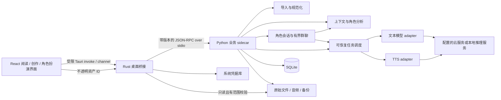

# Narravo（叙声）产品需求文档

| 项目 | 内容 |
| --- | --- |
| 文档版本 | v0.3，加入角色扮演、多人群聊与实时 TTS |
| 日期 | 2026-10-17，Asia/Shanghai |
| 产品形态 | 桌面应用，用户已确认 |
| 首发建议 | macOS Apple Silicon；后续 Windows x64；Linux 暂不承诺 |
| 产品阶段 | P0 首轮实现中；本文仍为完整需求基线，已实现范围与验证结果见 README 和评测记录 |
| 工作名称 | Narravo，中文「叙声」；名称可用性尚未核验 |
| 核心定位 | 本地优先的小说创作、情境朗读与有声角色扮演工作台 |

## 1. 产品愿景与问题

让用户从一个想法开始写小说，也能把已有小说文件变成可听、可编辑、可继续创作的作品。产品提供两个同等重要的入口：「新建作品」与「导入小说」。新建作品可从空白手写，或借助 AI 构思故事、设计人物与世界观、规划大纲、生成开篇和逐章创作；导入后可阅读、朗读、续写和改编。两条路径共用版本、设定、编辑器与音频系统。

启用情境朗读后，系统分析旁白、人物对白和表达情绪，为角色维持稳定声音；新写内容经用户接纳后也可以继续朗读。创作不要求先有文件、已有正文或完整大纲。

新增第三个独立入口「角色扮演」：用户自定义一个或多个聊天对象及其人设，以自己的身份或自定义用户身份进行单聊、群聊和剧情互动。回复结合会话上下文、人设与语境生成，可按角色稳定音色、当前语气边生成边朗读；无需先新建或导入小说。角色库、聊天记录与小说正文分别管理，共用模型配置、凭据、任务、声音编排、缓存和费用能力。完整需求见第 19 节；新增范围处于设计阶段，尚未实现。

需要解决的具体问题：

1. 小说来源格式不同，编码、章节、页眉页脚和换行常常破坏阅读与朗读体验。
2. 单一音色不能区分角色，情绪夸张或人物声音漂移会打断听书体验。
3. 长篇续写容易遗忘人物关系、提前泄露后续剧情、违反世界观，且缺少版本回退。
4. 整本上传、整本预生成会增加隐私顾虑、等待时间和模型费用。
5. 读书、听书和写作工具割裂，编辑一句话后往往需要重新生成大量音频。
6. 从零创作容易卡在灵感、开篇和章节规划之间；创作大纲中的未来事件又容易被模型误当成已经发生的事实。
7. 自定义角色聊天需要持续遵从人设、记住当前会话，并在多人互动中明确谁发言、谁知道什么；语音不能串角色、积压后继续播放过时回复。

产品目标是可靠地完成上述闭环，不把「完全理解文学语境」「永不出错的配音」或「无限上下文续写」作为宣传承诺。

## 2. 目标用户、场景与边界

### 2.1 用户

| 用户 | 主要需求 | 首要场景 |
| --- | --- | --- |
| 小说读者 | 导入现有电子书，持续听书，记住进度 | 导入 EPUB → 选择声音 → 播放下一章 |
| 长篇阅读用户 | 多角色对白，稳定音色，适度情绪 | 自动分析当前场景 → 修正说话人 → 连续播放 |
| 写作者和故事爱好者 | 按设定续写、改写、比较候选 | 从某章结尾创建分支 → 加入设定 → 生成 → 接纳 |
| 原创作者 | 从空白或一句灵感开始，持续完成小说 | 新建作品 → 构思/设定 → 大纲或直接开写 → 写章 → 修订 → 试听 |
| 角色扮演用户 | 自定义对象、人设、关系与场景，以文字和声音互动 | 新建角色 → 单聊/选择多角色群聊 → 情境回复 → 实时朗读 → 保存会话 |
| 本地模型用户 | 自选模型、控制数据流向 | 配置本地服务 → 离线分析和生成 |

首版界面和评测以简体中文小说为中心；英语文本应能导入，但英语情境识别和混合语言配音不作为与中文等同的质量承诺。

### 2.2 MVP 不做

- 小说网站爬取、盗版书源聚合、DRM 绕过。
- 账号、订阅计费、多人协作、跨设备同步、公共作品社区。
- 内置大型模型权重、训练平台、默认声音克隆、背景音乐自动制作。
- 扫描 PDF 的 OCR、多栏和竖排文档的高保真自动重排。
- 无限自动续写、无限自我评价、后台无预算整书生成。
- NovelAI 私有模型接入、私有接口逆向或与其文件格式的全面兼容。
- 真人在线聊天室、社交匹配、角色市场；Tavo 私有接口逆向、全量格式兼容或脚本生态复刻。
- 麦克风输入、ASR、全双工语音通话和语音自动检测打断不属于本轮 P0；本轮「实时语音」指文字聊天回复的低延迟 TTS 输出。

## 3. 这是不是一个 Agent 产品？

可以定位为「具有 Agent 能力的小说朗读与创作工作台」。仅调用一次 LLM 或 TTS 是 AI 功能；固定顺序的解析、分析、合成、播放是 AI 工作流。若系统接受目标，根据中间结果选择下一步，调用受限工具，维护进度和记忆，检查结果，并在预算内重试或停止，则可以称为任务型 Agent。

例如用户提出「把这一章制作成双角色听书，控制在本次预算内」：系统检查章节 → 提取角色 → 生成配音方案 → 合成片段 → 检查空音频和缺失片段 → 只重试异常项 → 保存结果和报告。这是计划中的 Narration Agent。

| 能力层级 | 本项目实现方式 | 阶段 |
| --- | --- | --- |
| AI 功能 | 灵感构思、设定/大纲建议、开篇、单次写作与续写、角色回复、单句合成 | P0 |
| 可恢复工作流 | 任务状态机、有限重试、缓存、断点恢复、人工修正、有界群聊轮次 | P0 |
| 有限自主 Agent | 根据检测结果选择工具、维护任务计划、局部修复 | P1 |
| 通用自主代理 | 任意浏览、任意执行代码、无限规划 | 不做 |

Agent 不是独立微服务的数量，也不要求多个大模型角色互相对话。首版采用普通应用服务和显式状态机；是否引入编排框架，等待实际复杂度证明其必要性。`AGENTS.md` 是编码助手的工程说明，与产品是否属于 Agent 是两回事。

多人群聊表示同一用户与多个虚拟角色互动，由应用控制有限发言队列；角色不能获得工具权限，也不因此升级为多 Agent 自治系统。

## 4. 版本范围与优先级

P0 是首个可用版本必须完成的闭环；P1 是体验增强；P2 是探索项。

| 编号 | 功能 | P0 | 后续 |
| --- | --- | --- | --- |
| IMP | 导入 | TXT、普通 EPUB、文本型 PDF；预览和章节修正 | P1 Markdown、DOCX；P2 OCR、其他电子书格式 |
| NEW | 新建作品 | 空白/灵感两种起点、创作简报、默认分支、自动保存 | P1 可复用的创作模板 |
| PLN | 创作规划 | 人物/世界观卡片、故事梗概、可编辑章节大纲；手动或单次 AI 辅助 | P1 分卷、场景卡、伏笔/时间线可视化 |
| LIB | 书库与阅读 | 搜索、目录、阅读进度、书签、主题 | P1 标签批量管理、阅读统计 |
| VOI | 角色与声音 | 旁白/对白、角色归属建议、稳定声音、人工锁定 | P1 别名合并建议、跨章节精细演绎 |
| TTS | 情境朗读 | 一家真实云服务、语气映射、分段合成、连续播放 | P1 第二家云服务、本地 TTS、音频导出 |
| WRT | AI 创作 | 空白开篇、依据章节目标生成单段/场景、光标续写、选段改写、候选接纳 | P1 多候选并列、完整章节/多章编排、局部一致性修复 |
| CTX | 上下文 | Memory、Author's Note、Lorebook、历史摘要、作者规划/读者无剧透策略、上下文查看 | P1 语义检索和时间线 |
| VER | 版本 | 原文保护、单父分支、生成记录、回退 | P1 分支图；P2 分支合并 |
| PRO | 模型与费用 | LLM/TTS 独立配置、能力检测、预算、用量记录 | P1 更多原生适配器 |
| DAT | 数据管理 | 本地保存、备份恢复、TXT/Markdown 导出、缓存清理 | P1 EPUB/音频导出；P2 同步 |
| AGT | Agent | 可观察工作流和人工控制 | P1 有限自主修复与长任务计划 |
| RPL | 扮演角色与身份 | 独立角色库、自定义人设/用户身份、场景、开场白、示例对白、版本与锁定 | P1 角色卡格式导入导出、模板、复杂关系可视化 |
| RCH | 角色聊天 | 单聊、流式回复、会话记忆、上下文预览、编辑/重试/分叉、本地记录与导出 | P1 更丰富的长期记忆整理与跨会话显式复用 |
| RGR | 多人群聊 | 多角色成员管理、@指定、轮流、全员及有界情境发言、停止/跳过 | P1 更复杂的舞台调度与用户明确授权的有限连续演绎 |
| RTV | 聊天实时 TTS | 回复分句后低延迟合成播放、稳定角色音色、按人设/上下文调整语气、停止与重播 | P1 原生流式音频优化、ASR/按键说话；全双工通话另行验证 |

P0 只需一个 TTS 服务商和一个通过验收的文本模型；自定义兼容端点只保证已测试的能力子集，不意味着支持所有厂商所有参数。

P0 必须能在没有任何导入文件的情况下完成「新建 → 开篇 → 编辑/接纳 → 下一章 → 朗读/文本导出」。基础构思与大纲辅助属于 P0；自动串行写完多章属于 P1。手写、管理设定和导出不依赖模型配置，AI 写作只依赖 LLM，朗读才需要 TTS。

v0.3 将角色扮演基础闭环纳入 P0：独立创建角色 → 单聊或多人群聊 → 流式回复 → 按角色实时朗读 → 打断/继续 → 重开及导出。此优先级是本轮规划，不代表已有实现；保留原有写作与听书验收。角色管理与历史浏览不依赖模型，文本聊天只依赖 LLM，TTS 未配置或失败不得阻断文字回复。

## 5. 信息架构与核心交互

### 5.1 页面

1. **书库/作品库**：同等展示「新建作品」「导入小说」；包含最近编辑/阅读、搜索、封面、来源和状态，区分原创、导入及其创作分支。
2. **阅读/听书工作台**：左侧目录，中间正文，右侧角色和朗读设置，底部播放器。窄窗口可折叠两侧面板。
3. **创作工作台**：左侧章节与大纲，中间正文编辑器，右侧可切换创作简报、人物/世界观、记忆、作者备注和生成设置；候选区显示开篇、写作或规划建议。提供分支切换、章节状态与上下文模式。桌面三栏独立滚动，正文不撑大整页或带动两侧；正文标题、编辑工具与底部字数保持可见，目录和右侧内容过长时各自滚动。
4. **任务中心**：导入、分析、合成、导出的进度、费用、取消、重试、失败原因。
5. **设置**：模型服务、密钥、数据目录、预算、缓存、主题、快捷键和诊断信息。
6. **角色库**：独立顶级入口，提供「新建角色」「发起单聊」「发起群聊」，展示人设版本、声音绑定和最近会话；空书库也能直接进入。
7. **角色扮演会话**：左侧会话列表，中间按发言人显示聊天气泡与生成状态，右侧管理角色、人设、用户身份、场景、记忆、发言规则和声音；输入区可 @，提供停止本轮、停止语音、重试与上下文查看。

播放器包含播放/暂停、上/下一段、上/下一章、15 秒快退/快进、语速、定时停止、当前声音、准备状态。首版语速范围建议 0.75–2.0 倍；播放器倍速与 TTS 合成语速分开显示。

### 5.2 导入到朗读

选择文件 → 本地检查 → 解析预览 → 修正编码/章节 → 入库 → 选择普通朗读或情境朗读 → 配置 TTS（情境模式同时配置 LLM）→ 展示数据发送范围和预计用量 → 播放。

默认先准备当前位置前后的小范围文本，播放后预生成后续片段，不等待全书分析。角色未知时用默认声音并标记待确认，不阻塞整章播放。

### 5.3 续写到试听

选择分支和光标位置 → 写明续写意图或使用默认继续 → 查看本次上下文 → 流式生成候选 → 停止/重试/编辑候选 → 接纳到当前分支 → 更新受影响摘要 → 仅为改变的文本重新配音。

用户在旧章节插入内容时，明确选择「从这里分叉」或「在当前分支插入」。候选不能静默覆盖原文。编辑期间移动光标不改变已经发出的生成请求目标。

### 5.4 示例

输入：`林舟压低声音说：“别开灯。”苏宁停了下来：“你听见了吗？”`

期望：旁白采用书籍默认音色；林舟使用其已绑定音色并建议轻声；苏宁使用其已绑定音色，依据上下文建议疑问/紧张。系统不得仅因问号就认定恐惧。用户可以把林舟改为普通语气，也可以将该人物的声音锁定。

### 5.5 从零开始的创作路径

点击「新建作品」→ 选择「空白写作」或「从灵感开始」→ 创建作品与默认分支 → 可选填写创作简报 → 手动建立或让 AI 提议人物、设定和大纲 → 选择第一章 → 直接手写或生成开篇候选 → 编辑/接纳 → 新建下一章并继续 → 修订 → 试听/导出。

「空白写作」立即进入编辑器，书名默认为可修改的「未命名作品」，不要求完成向导。「从灵感开始」可只填一句话，例如「一名失忆的修钟匠发现，全城的人每天都少活一分钟」；AI 提出的背景、人物和情节均为候选，用户可采用、编辑、跳过或重新生成。

没有大纲也允许写作；有大纲时可从任意章节开写。跳写第三章时，系统明确区分前两章的计划与实际正文，不编造它们已写完的摘要。未配置 LLM 时保留所有手工创作入口；未配置 TTS 不阻止写作。

### 5.6 角色扮演与群聊路径

进入角色库 → 自定义角色人设与可选声音 → 选择单个角色单聊，或选择多个角色创建群聊 → 可选设置用户身份/场景 → 发送文字 → 查看角色流式回复并按设置自动朗读 → 随时停止语音或停止整轮 → 保存、重开与导出聊天。

角色可独立于小说创建。用户可从作品当前可见的人物资料明确复制出扮演角色，预览带出的字段；聊天不会自动成为小说正文。群聊显示待发言队列，用户可指定下一位、禁言、跳过或结束本轮，细则见第 19 节。

## 6. 导入、书库与正文模型

### 6.1 格式支持合同

| 格式 | P0 行为 | 限制与失败处理 |
| --- | --- | --- |
| TXT | UTF-8/BOM、UTF-16、GB18030 的检测与手动覆盖；空行分段；中英文章节规则 | 编码不确定先预览；没有目录时按规则分章，允许保持单章 |
| EPUB | 读取 EPUB 2/3 的 package/spine 顺序、导航目录、标题、作者、正文与封面 | 限无 DRM 的流式排版电子书；脚本不执行；固定版式、媒体覆盖、特殊排版提示限制 |
| PDF | 逐页抽取文本；保存页码来源；尝试页眉页脚去重和断行恢复 | 文本型优先；无文本或低质量提取提示 OCR 尚不支持，不能显示为成功空书 |

PDF 不承诺完整恢复原始排版；其文本抽取和扫描识别是不同能力。pypdf 文档明确区分图像型页面与可提取文本，并指出大内容流的内存风险，因此 PDF 导入需逐页限制资源和隔离失败。[pypdf 文档](https://pypdf.readthedocs.io/en/stable/user/extract-text.html)

导入预览展示前几个章节与抽样正文、检测编码、章节总数、疑似问题及来源页码。页眉页脚和断行修复是可撤销的规范化操作，不能直接改写原文件。

### 6.2 默认资源限制

这些是初始产品保护值，允许开发后根据基准测试调整：单个文件上限 100 MiB、PDF 上限 2,000 页、EPUB 解压总量上限 500 MiB、单条目 50 MiB、条目数 10,000；超过时说明原因并停止，不在 UI 中无限加载。PDF 单页解析采用独立进程超时/内存保护，坏页允许跳过，但必须记录遗漏页数并要求用户确认是否接受不完整导入。

### 6.3 正文数据规则

- 导入作品保留只读原文件副本与 SHA-256；原创作品允许没有原文件。解析正文、用户编辑和 AI 候选各有独立来源标记。
- 规范层级为 `Book → Chapter → Block → TextRevision → NarrationSegment`。
- `Block` 通常是段落；朗读片段可将段落拆成多个说话人和句段。
- 每次规范化保留到源文件的定位映射：TXT 字节区间、EPUB 资源路径/元素定位、PDF 页码和可用的文字定位。
- 应用内部的文本区间统一使用 Unicode code point 索引与左闭右开范围；JS 的 UTF-16 索引在边界显式转换，并测试 emoji、组合字符和生僻字。
- 章节顺序可人工调整；书签绑定稳定 block ID、修订号和文本锚点，不只存易变化的页码。
- 相同哈希重复导入时，可打开已有书籍或创建独立副本，不默默合并用户编辑。
- 首版每章按需加载和索引，避免把整本长篇小说塞入一个编辑器状态。
- `Book` 作为统一作品根实体，`origin_type=original/imported`；原创作品的 source_asset_id/source_hash 为空，import_status 为 not_applicable，不伪造空 TXT 或导入成功记录。
- 新建作品在一个事务内创建默认分支、空快照、第一章与稳定空段落锚点；空正文是合法状态，可直接手写或生成开篇。
- 章节标题、排序、增删与大纲映射纳入分支快照。删除采用可恢复的版本变更，重排后重新计算依赖顺序的可见性和摘要，不能改动其他分支。

### 6.4 阅读与检索

支持字体、字号、行距、明暗主题、章节跳转和搜索结果定位。搜索覆盖标题、作者和正文；正文索引使用 SQLite FTS5，自行生成中文分词索引字段，查询使用同一分词流程，短词提供参数化子串回退。不能假设默认英文 tokenizer 就能解决中文词语检索。

## 7. 情境识别与声音编排

### 7.1 分析流水线

1. 规则识别引号、段落、可能的对白边界，保留所有原文字符。
2. LLM 接收当前片段、有限前后文、当前章节摘要、人物名册和已锁定映射。
3. 返回结构化片段标注：旁白/对白/内心独白、角色候选、语气、强度、证据位置。
4. 本地校验片段覆盖率、重叠、角色合法性、文本修订版本和允许的语气值。
5. 生成 `NarrationPlan`，通过 TTS adapter 编译为服务商支持的参数。
6. 调度合成并缓存；播放按原始文本顺序进行。

LLM 只能标注文本区间，不能通过重述文本改变原文。结构化结果无效最多修复一次；仍失败时回退普通旁白并标记失败，不无限请求模型。

### 7.2 角色识别

角色档案包括稳定 ID、姓名、别名、声音绑定、出场位置和人工锁定状态。声音建议可参考文本明确描述的年龄、音质、身份和用户偏好；信息不足时展示候选，不把模型推测当事实。

人物的真实身份、别名和关系要带可见剧情范围。听到第三章时，不能用第十章揭晓的身份覆盖前三章人物信息；角色列表默认隐藏尚未读到的条目。

同名角色与跨书角色不自动合并。合并/拆分角色会显示影响范围，并使相关分析和音频按需失效；人工锁定优先级最高。

### 7.3 语气与稳定性

应用内部初始标签：`neutral / happy / sad / angry / tense / surprised / gentle / whisper`。这些是统一语义，不是任何厂商 API 的通用参数。强度范围 0–1，默认偏克制；先保证旁白/人物区分和持续音色，再优化细腻表演。

人物音色默认整书稳定，情绪只改变演绎方式。场景可以改变语速、停顿和轻重，但不能每句话重新随机选声音。情绪之间采用平滑策略，避免相邻短句剧烈跳变。

模型返回的 confidence 仅为排序提示，不是校准概率。初始小于 0.7 的候选显示「需确认」，阈值在人工标注集上调整；即使分数高，也不得覆盖人工锁定。

### 7.4 人工纠正

选中一句或一段可以指定说话人、旁白、声音、语气、强度、读音和停顿。作用域分为「这一处」「本章该角色」「全书该角色」，默认这一处。预览修改影响的片段数和预计重生成用量。

读音词典保存专名、数字和多音字的朗读替换；原文保持不变。只有支持的服务商才显示音素或 SSML 控件；不能把标记作为普通文本念出来。

## 8. TTS 合成、缓存与播放

### 8.1 服务选择与能力适配

P0 首选接入阿里云百炼语音合成 HTTP API，默认候选为文档可见且支持指令控制的 Qwen-Audio-TTS 系列；具体 model ID、区域和音色在 M0 通过账户实测后固定。当前官方文档列举 `qwen-audio-3.1-tts-flash`，并说明不同模型和声音的指令支持范围不同；这不代表用户账号必然可用。[官方语音合成指南](https://help.aliyun.com/en/model-studio/non-realtime-tts-user-guide)

云端服务接口、模型权重和本地推理接口分别管理。P1 本地 TTS 候选为 Qwen3-TTS，通过独立推理服务接入，先测目标硬件的速度、内存和安装复杂度，不宣称普通笔记本必然实时运行。[Qwen3-TTS 官方仓库](https://github.com/QwenLM/Qwen3-TTS)

能力描述至少包含：

```text
provider_id, model_id, region, adapter_version
languages, voices, max_input_units, input_unit_type
supports_streaming, supports_instructions, emotion_values
supports_ssml, supports_speed, supports_pitch, supports_timestamps
audio_formats, sample_rates, pricing_revision
```

每项能力带 `verified / declared / unknown` 状态和更新时间。连接测试只说明认证和短样本可用，不能自动证明全部能力。UI 根据能力隐藏或禁用参数，解释无法生效的原因。

### 8.2 合成与预取

- 默认以句子和说话人边界分段，首段目标 50–120 个中文字符，后续目标 100–300；实际受提供商长度单位和限制约束。
- 前后文只供语境分析或该服务明确支持的 context 字段使用，不能拼到待朗读文本里导致重复播放。
- P0 以短片段完整生成后播放为稳定基线，边播放边预取；真流式 PCM 为能力增强，单独验证音频边界、取消和背压。
- 角色聊天使用第 19.6 节的低延迟分句策略，不照搬听书的较长预取窗口；无需等待整条回复完成。当前代码仅支持已保存章正文的完整片段播放，聊天分句管线尚未实现。
- 默认预取未来约 60–120 秒音频，限制每服务商并发为 2，可配置；跳章后取消不再需要的待执行任务。
- 不把临时远程音频 URL 当持久资产；下载并验证到本地后才标记 ready。
- 重试只覆盖超时、限流、部分服务端错误；认证错误、额度不足和不支持参数必须明确提示。
- 不静默切换服务商，以免改变声音、费用和数据接收方。用户可预先选择允许的备用配置。

### 8.3 缓存与修订一致性

音频缓存键包含：原文修订哈希、实际送入 TTS 的 spoken text、语气指令、角色声音修订、读音词典修订、provider/model/region、所有合成参数、音频格式、adapter 和 prompt/plan 版本。若提供商的 seed 实际可用且已设置，也应纳入缓存键。

分析缓存另外包含邻近上下文哈希、人物表和摘要版本。用户编辑一句话后，需失效受其语境影响的分析窗口；音频仅在重新生成的计划指纹变化时重做。不能只按句子文字判断一切仍有效。

播放列表固定到某个正文版本和计划版本。编辑或换音色后，当前播放可结束当前片段，新计划从下一边界启用；任务结果若基于旧版本，保留为旧资产或丢弃，不能混入新版本列表。

### 8.4 播放行为

支持连续跨片段/跨章节、书签、进度恢复、定时停止和倍速。没有时间戳的服务按片段高亮；不能用均分时长伪装准确逐字对齐。逐字高亮需要服务商时间戳或后续强制对齐能力。

缓存命中时不重新调用 TTS。离线时可读书和播放已缓存片段；未缓存部分显示不可用原因。关闭「启用外部服务」后，禁止新建出网请求；已有请求尽力取消，并说明已发出的内容不能撤回。

P1 提供选段/章节/整书的 WAV、MP3 或 M4B 导出；以实际编码链路支持的格式为准，导出操作使用独立任务，不阻塞播放。

## 9. 从零创作、续写与修订

### 9.1 从 NovelAI 借鉴什么

借鉴的是故事编辑器与上下文管理方式：Memory 保存长期设定，Author's Note 指定当前写作方向，Lorebook 按内容激活设定条目，用户可以查看生成时实际使用的上下文。以上是交互设计参考，不代表复制其模型或保证相同写作质量。[Story Settings](https://docs.novelai.net/en/text/editor/storysettings/) · [Lorebook](https://docs.novelai.net/en/text/lorebook/) · [Context Viewer](https://docs.novelai.net/en/text/editor/advancedsettings/)

### 9.2 生成操作

| 操作 | 输入与行为 | 版本 |
| --- | --- | --- |
| 灵感与故事梗概 | 根据一句想法/创作简报提出可编辑候选，不直接创建正文 | P0 |
| 设定与大纲建议 | 对选定人物卡、世界观或章节大纲生成结构化候选，逐项接纳 | P0 |
| 写开篇 | 空正文时依据已填写的意图与设定生成首段/首场景 | P0 |
| 按章节目标写一段 | 从指定章的目标、允许使用的规划与当前正文生成一次候选 | P0 |
| 继续写 | 从光标前文、记忆和设定生成后续段落 | P0 |
| 按指令续写 | 加入本次剧情意图、视角、节奏、目标长度 | P0 |
| 选段改写 | 原段作为输入，候选替换结果等待接纳 | P0 |
| 重试 | 保留同一输入快照，生成新候选；每次重新计费 | P0 |
| 停止 | 中止流式接收，保留已收到的未接纳候选 | P0 |
| 从这里分叉 | 在指定修订位置创建新分支，不改父分支 | P0 |
| 多候选比较 | 并列 2–3 个结果，展示总用量 | P1 |
| 编排完整章节/多章 | 基于已选定大纲分步生成并检查，累计预算与字数限制，支持中断和逐段接纳 | P1 |
| 一致性检查 | 找出人物、时间、物品和规则冲突，提出修改建议 | P1 |

P0 默认每次一个候选，可通过重试逐个积累比较。目标长度是提示，不是精确保证；输出 token 上限是硬限制，UI 区分两者。`temperature/top_p/stop/seed` 等控件只在 adapter 明确支持时启用。

有可用前文时，「本次创作意图」为可选项，留空点击「继续写」即使用自然承接前文的默认指令，保持人称和文风并续完未结束的句子；不得因未填旁栏阻断续写。当前位置之前的正文可来自前章，不包含未接纳候选或未授权的后文。完全无前文且无有效意图时才提示填写开篇想法，不自动付费构思。

### 9.3 记忆与世界观

- **Memory**：当前故事的长期背景、主要人物关系和重要已发生事实，可手动编辑。
- **Author's Note**：当前场景的视角、叙述风格、节奏和创作要求，短小且高优先级。
- **Lorebook**：人物、地点、势力、能力规则、物品等条目；支持关键词/别名触发、始终启用、优先级、token 预算和剧情可见位置。
- **章节摘要**：从当前分支已接纳内容生成，引用原文区间；AI 摘要可修正，不自动升级为确定事实。
- **事实来源**：正文明确事实、用户确认设定、创作计划、模型推测分别标记。人物未来转变与已发生事件分开；冲突显式提示，不能为遵从新设定而悄悄重写既有正文。

P0 用规则触发和中文全文检索；P1 才加入嵌入与语义召回。不能因为用了 RAG 就假定长篇一致性得到解决。

### 9.4 上下文预算与无剧透规则

每次请求根据明确的 context_policy 构造独立快照：

```text
系统约束 + 本次任务 + Author's Note
+ 用户锁定的关键 Memory / Lorebook
+ 当前分支可见的历史摘要与相关设定
+ 光标之前的最近正文
+ （仅改写模式）选段及用户允许的局部后文
+ （仅作者规划策略）已选择的创作简报、章节目标与可用规划，标注尚未发生
```

满足 `输入 token + 预留输出 token + 安全余量 <= 已配置的模型上下文上限`。adapter 提供 tokenizer 时按实际计算；未知时保守估算并标示估算，遇到超限重新缩减。裁剪先移除低优先级检索结果，再压缩旧摘要，再缩减远处正文；固定系统要求、当前任务、锁定设定和存在时的最低近文窗口不可静默删除，仍放不下则让用户调整。空白开篇不要求前文和摘要；规划内容同样计入预算。

上下文查看器展示每项来源、字数/token、是否估算、触发原因、裁剪内容和将发送到的服务商。Memory 和 Author's Note 的布局是本项目策略，不声称完全复刻 NovelAI 的注入顺序。

导入作品默认 `reader_safe`（无剧透续写）：只读取当前分支、光标之前的可见内容。来源于正文的摘要、Lorebook 和角色信息必须有 `branch_id + source_revision + visible_from`；在旧章节分叉后，不能沿用包含原书后续剧情的全书摘要。用户自行创建设定以独立设定修订记录来源，不伪造正文 source_revision。原创作品默认 `author_plan`，详见第 9.9 节；主动选择 `full_rewrite`（参考全书改编）才允许纳入后续正文。模式在工作台可见，不能因检索、切换分支或 AI 建议而自动扩大范围。

### 9.5 候选接纳与分支

生成结果记录模型、输入快照、参数、时间、用量和来源，状态为 `streaming / ready / interrupted / accepted / rejected / failed`。正文候选只有接纳后才进入正式正文、记忆索引和默认朗读列表；规划候选接纳后只更新对应规划实体，不进入正文或已发生事实。分项接纳的规划候选需另存条目级决策和已采用的内容版本，不能只用一个 accepted 标记表示全部采用。

接纳操作必须检查 `base_revision` 和原始插入锚点。期间正文已变化时，展示冲突并允许重新定位或重新生成，不按照最新光标盲目插入。接纳本身为一个可撤销事务。

P0 分支采用单父版本树，不实现复杂合并；旧版本不可覆盖。大型章节使用段落级修订与快照清单，避免每次生成复制全书。用户可以试听候选，但明确标注「草稿试听」，不将其自动接纳。

### 9.6 新建作品与创作简报（P0）

新建操作本地完成，不产生模型调用和费用；标题可为空并自动命名。选择创作方式只决定初始界面，不锁定后续能力，原创作品随时可转为手写或 AI 辅助。

创作简报 `CreativeBrief` 可填写：暂定书名、语言、题材/子类型、目标读者、故事核心问题、一句话梗概、叙述视角与时态、风格描述、节奏、预计篇幅、每章目标字数、期望结局方向、希望出现/避免的情节。除生成所需的最小意图外均可留空，不强迫用户先填表。

请求 AI 开篇时，至少提供当前指令、简报或已确认设定中的一种有效意图；完全空白时提示填写一句灵感，或明确选择「帮我构思」。不能在用户仅新建文档时自动付费生成。目标字数用于提示和进度估算，token 上限用于请求边界，不保证一次生成满足全书篇幅。

界面呈现「构思 → 规划 → 写作 → 修订」导航，但用户可跳步、返回和并行编辑。简报修改保存版本；已经发出的任务引用旧快照，接纳时检测依赖是否变化。

### 9.7 人物、世界观与大纲（P0 基础，P1 增强）

| 对象 | P0 可编辑内容 | 行为 |
| --- | --- | --- |
| 故事梗概 | 核心冲突、起点、主要转折、结局方向 | 手写或单次 AI 建议；结局属于计划，不是既成事实 |
| 人物卡 | 姓名/别名、目标、动机、性格、关系、缺陷、预期成长 | 与朗读角色共享稳定 ID，声音是独立可选绑定 |
| 世界观卡 | 地点、时代、组织、规则、能力限制、禁用设定 | 纳入 Lorebook；区分已确认设定与未采纳建议 |
| 章节大纲 | 标题、章节目标、视角人物、时间地点、主要冲突、关键事件、结尾钩子、目标字数 | 创建、修改、排序、绑定正文章；重排不会自动改正文 |

P0 使用一层章节大纲；分卷、场景卡、人物关系图、伏笔板和时间线可视化属于 P1。允许先写正文再补大纲；章节可以暂不绑定大纲，大纲也可以暂时没有正文。

AI 生成大纲采用带 schema_version 的结构化候选，条目有候选局部 ID；应用接纳时分配稳定实体 ID。一次提议默认最多 20 个章节条目，更多分批生成并展示累计费用。无有效结构化输出时使用有限修复与 schema 校验；无法通过时保留可读候选并允许手动整理，不写入半个损坏的大纲。

用户可逐项接受、编辑后接受、拒绝和重试；人工已锁定的设定或大纲条目不被批量建议覆盖。用户只采用第 2 个提议时，不得顺带创建未采用的人物或关系；跨条目引用缺失时提示补齐、替换或取消该条目，不能产生悬空 ID。

### 9.8 开篇、章节写作与修订（P0）

1. 创建章节后可直接输入；空章提供「写开篇」和「根据章节目标写一段」。
2. 每次生成固定目标章、锚点、分支、正文版本及简报/设定/大纲依赖版本，流式输出到候选区。
3. 用户可编辑候选、接受全部或选中部分、拒绝、停止和重试；接纳精确保存已采用文本、候选修订与范围，未采用部分不进入正文。中断结果默认需手工检查，重复接纳不重复插入。
4. 在该章继续写时使用已经接纳的正文；新建下一章时以当前分支之前的正文、可见摘要及所选章节计划构造上下文。
5. 用户可将章状态设为 `not_started / drafting / revising / complete`；这是人工管理标签，与生成任务状态独立。生成完成不等于章节完成，AI 不自动标记全书完结。
6. 选段支持扩写、压缩、润色和改写方向，均复用候选与差异预览；保留原文和撤销入口。

P0 的「按大纲写作」是用户逐次触发的一段/一个场景，不是后台自动写完整本书。P1 完整章节/多章任务必须明确章节范围、累计预算和停止条件，分段保存候选；默认在接纳检查点暂停，不把前一段未接纳候选当作正式事实继续扩张。

### 9.9 作者规划与读者知识边界

| context_policy | 默认入口 | 可使用内容 | 边界 |
| --- | --- | --- | --- |
| reader_safe | 导入小说后续写/情境朗读 | 当前分支光标/播放位置之前的正文和可见设定 | 过滤后文、未来摘要及提前揭示的别名；作者隐藏规划不可自动进入 |
| author_plan | 原创作品的创作操作 | 当前目标之前的正文、作者确认设定、选中的大纲与未来计划 | 未来计划明确标注未发生，禁止自动检索后续已写正文 |
| full_rewrite | 用户显式选择全书改编/重构 | 当前作品中用户指定范围的正文与规划 | 显示会使用的后文范围；仍禁止跨作品/无关分支检索 |

作者知道未来结局与读者当前知道什么是两种信息。对规划条目分别记录 `context_role=setting/planned_event/established_fact`、来源修订，以及披露约束 `allowed_from`（稳定章节 ID）或 `author_only`。`context_role` 与内容来源、人工锁定是不同维度：用户确认一个计划，并不意味着事件已经发生。

`author_plan` 可把作者选中的秘密用于安排伏笔，提示中区分「写作参考」与「本章允许披露」。选中 author_only 条目时提示其会发送给模型；该标记限制正文披露，不意味着绝不进入生成上下文。人工确认设定不必等到正文提及才能用于写作，但未来事件不得加入「此前已发生」摘要。

披露标签和提示不能保证模型绝不泄露；P0 提供上下文查看、结构化分区和候选人工接纳；P1 再增加语义泄露检测与一致性建议。禁止宣传为绝对防剧透保证。朗读分析始终使用当前位置的 reader_safe 视图，即使该原创作品的写作模式是 author_plan。

作者改变结局或重排章节后，按稳定 ID 和新顺序重算披露位置；被删除的披露目标标记为需要处理，不默认提前公开。分叉继承当时的设定/大纲快照，各分支后续独立演化。导入书籍不能仅通过打上 original 标签自动绕过 reader_safe 策略。

### 9.10 规划变更与实际故事一致性

大纲、简报、人物和世界观采用独立修订并由分支快照引用。生成请求保存依赖指纹；即使正文未变，若目标大纲或关键设定在生成过程中发生变化，接纳也应提示版本冲突，允许比较、保留为候选或重新生成。

修改规划不会覆盖已有正文。系统依据显式引用显示可能受影响的章节、摘要和待接纳任务，标记「待检查」；P0 的影响范围是引用依赖，不声称发现所有语义冲突。用户选择要重写的段落后再生成候选，已写文字保留版本。变更尚未写入正文的计划不应触发整书音频重生成；仅在实际朗读文本或有效配音计划变化时失效音频。

AI 提取的人物状态和事件摘要保留来源锚点及待确认标记；与人工设定冲突时展示冲突，不自动把设定卡改成模型猜测。手工输入正文属于用户直接编辑，可直接形成正文修订；「候选必须接纳」只针对 AI 输出，不增加手写流程的确认步骤。

### 9.11 创作进度、导出与恢复

作品显示总字数、章节列表、各章状态与目标进度。P0 字数口径固定为「非空白 Unicode code point 数」，不含规划卡片与未接纳候选；另行展示的 token 估算不能混称字数。完整段落的真实编辑保存与候选自动保存独立，退出重开后保留两者状态。

默认 TXT/Markdown 导出仅包含所选分支的当前正文及章标题，不夹带作者秘密、提示词、大纲或被拒绝候选。用户可另选「规划资料导出」生成独立文件；完整项目备份包括简报、规划修订、分支、候选决策和进度。空作品的备份合法；空正文文本导出提示尚无正文。没有正文时不创建朗读或 TTS 任务。

## 10. 模型配置、费用与任务恢复

### 10.1 提供商管理

LLM 与 TTS 分别配置名称、base URL、model ID、区域、API Key 引用、超时和并发限制。P0 文本层采用兼容 OpenAI Chat Completions 的协议 adapter；选择一家实际账户可用的服务作为验收基准，不以协议兼容推断结构化输出、工具调用或全部采样参数都可用。

本地文本模型预留 Ollama 兼容端点。Ollama 官方说明其支持 OpenAI API 的一个子集，因此应维护端点能力合同和对应的集成测试。[Ollama 官方兼容说明](https://docs.ollama.com/api/openai-compatibility)

### 10.2 费用规则

首次配置云端服务时说明将发送的内容类别；以后在既有配置范围内正常操作无需逐句重复确认。整书批量生成或超出用户设定预算时需再次确认。

- 文本模型按输入/输出 token 分别估算，TTS 按厂商字符、token、音频时长或调用次数计费单位计算。
- 价格配置带币种、计价单位、来源与更新时间；未知价格显示「费用未知」，绝不能显示为零元。
- 预算同时包括每次任务的金额上限（已知价格时）和请求/token/字符上限（始终可用）。未设置任何上限时禁止开启自动整书任务。
- 并发调用前以事务预留预算，完成后按实际 usage 对账，避免两个并发任务同时花掉相同余额。
- 估算不是厂商账单，不能保证 API 超时后完全不收费；出现远端是否完成未知的情况，记录 `unknown_outcome`。
- 不对未知完成状态无限重试；优先使用提供商 request ID 查询（若支持），否则提示可能重复计费，再按用户配置决定重试。
- 默认自动重试最多 2 次，指数退避加抖动，并遵守 Retry-After；重试同样消耗预算。

费用公式示意：`LLM 成本 = 输入量 × 输入单价 + 输出量 × 输出单价`；`TTS 成本 = 可计费文本单位或音频单位 × 对应单价`。单价的分母按该提供商实际口径换算，不写死某个价格。

### 10.3 任务状态

```text
queued → running → succeeded
                 → failed
                 → paused
                 → cancelled
                 → needs_review
```

任务记录 checkpoint、attempt、request_id、输入版本、幂等键、预算预留和 heartbeat。桌面应用退出时将可恢复任务保存；重启后 `running` 不能直接等同成功，需要检查产物与远端状态。

本地幂等性保证相同输入不重复写入产物，但不能保证云端计费恰好一次。音频先写临时文件，验证后原子改名，再在数据库事务中标记 ready；启动清理器处理残留临时文件和无引用资产。

### 10.4 P1 Agent 的限制

Narration Agent 和 Writing Agent 共享任务引擎，但各自有工具白名单。朗读可用 `parse/analyze/cast/synthesize/validate_audio`，创作可用 `retrieve/outline/generate/check_consistency`；都无通用 shell、任意文件写入或任意网络抓取工具。

Writing Agent 可以围绕用户确认的简报安排「梗概 → 设定 → 大纲 → 指定章节候选」任务，持久化各阶段产物和依赖；模型不能自行将规划或正文候选接纳为正式内容。每阶段结束提供候选检查点，已有手工设定和正文不因重试整条工作流被覆盖。

单个自主任务初始最多 20 次模型调用、每个问题最多 2 次修复，并受用户设定费用/字数/时长限制。遇到无法识别角色、设定冲突、预算不足或连续失败时停止并提供部分结果。自动质量检查只能证明结构或特定信号，不能把模型自评当作客观文学评分。

## 11. 技术栈与架构决策

### 11.1 选型表

以下是拟定选型，开工时锁定经过验证的具体版本；不在本文声称某个依赖是最新版本。

原创与导入共用作品模型、规划独立修订的设计见 [ADR-0001](docs/adr/0001-unified-writing-project.md)，已有实现子集见 [ADR-0002](docs/adr/0002-local-writing-foundation.md)；现有模型与基础语音见 [ADR-0003](docs/adr/0003-provider-integration.md)。v0.3 的独立角色会话、修订与音频边界见 [ADR-0005](docs/adr/0005-roleplay-conversations.md)，尚待实现。

| 层 | 技术 | 作用与理由 |
| --- | --- | --- |
| 桌面壳 | Tauri 2 + Rust | 窗口、文件选择、系统凭据、sidecar 生命周期、受限本地资源读取 |
| UI | React + TypeScript + Vite | 阅读器、角色面板、设置和工作台 |
| UI 组件 | Tailwind CSS + Radix UI | 统一样式与基础可访问交互 |
| 状态与校验 | Zustand + Zod | 临时 UI 状态、IPC 边界验证；持久化真相在数据库 |
| 编辑器 | Tiptap/ProseMirror 核心 | 段落编辑、稳定锚点、候选接纳；不依赖付费协作功能 |
| 业务引擎 | Python 3.12 + uv | 文件解析、模型适配、上下文装配、任务调度；版本以打包验证为准 |
| 合同模型 | Pydantic v2 + JSON Schema | 分析结果、任务协议和模型输入输出校验 |
| HTTP | httpx | 云端与显式配置的本地推理服务；流式请求、超时、取消 |
| 本地数据库 | SQLite WAL + SQLAlchemy 2 + Alembic | 小说、修订、任务、缓存索引；单业务写入端 |
| 检索 | SQLite FTS5 + jieba 预分词 | 中文全文检索；P0 不引入向量数据库 |
| TXT | charset-normalizer + 显式编码覆盖 | 编码检测与人工纠正 |
| EPUB | zipfile + lxml + BeautifulSoup | 解析容器、spine、导航和清理后的正文；禁用外部实体与远程加载 |
| PDF | pypdf | 文本型 PDF 按页提取与源定位 |
| 音频播放 | Web Audio API + HTMLAudioElement | 分段播放、预加载、进度和倍速；实际拼接效果需在 WKWebView 验证 |
| 凭据 | Rust keyring crate 对接系统凭据库 | macOS Keychain / Windows Credential Manager；不落明文数据库 |
| 分发 | PyInstaller + Tauri bundler | 每个目标平台构建 Python sidecar 并一起打包 |
| 测试 | pytest、Vitest、React Testing Library、Playwright、cargo test | 领域逻辑、UI、浏览器流程和 Rust 边界；桌面原生行为补充目标系统验证 |
| CI | GitHub Actions | 静态检查、测试、按目标 OS 打包、依赖与产物扫描 |
| P1 扩展 | 独立本地 TTS 服务；可选 FFmpeg 导出 | 重模型不放入默认安装包，FFmpeg 构建及分发许可另做核验 |

选择 Tauri 而非纯浏览器，是为了本地文件、系统凭据和后台任务的桌面体验；选择 Python sidecar 是为了复用解析和模型生态。代价是 Rust、TypeScript、Python 三种语言以及跨平台打包复杂度，所以 M0 必须先做整链路验证。

Tauri 官方支持将 Python 等外部二进制作为 sidecar 打包，并要求匹配目标平台的二进制，因此不能把开发机 Python 环境当作用户安装前提。[Tauri sidecar 文档](https://v2.tauri.app/develop/sidecar/)

### 11.2 运行时结构



首版 Python 不启动开放的 localhost HTTP 服务器；Rust 持有唯一 sidecar 进程，通过换行分隔 JSON-RPC 2.0 通信。请求/响应使用 ID，流式进度和 token 使用带 task ID、seq、revision 的通知；stdout 专用于协议，诊断写脱敏 stderr。大音频文件不通过 JSON/base64 传输。

文件访问由 Rust 校验应用数据目录和用户授权导入来源，向 UI 暴露不透明资产 ID，经受控协议提供音频和封面。UI 不能向后端传任意绝对路径要求读取。sidecar 运行属于应用内部信任边界，不能误称为完整 OS 沙箱；解析高风险文件另用受限子进程。

密钥由 Rust 读取后通过内部私有调用供任务使用，绝不作为普通 RPC 返回给 UI，也不放入命令行参数。Python 内存中可能持有请求所需密钥；退出即清理引用，日志严格脱敏。不能宣称密钥从未离开系统钥匙串。

### 11.3 推荐仓库布局

以下为目标布局；当前已有实现的实际文件与范围见 README，不要求一次性创建所有目录。

```text
Narravo/
  README.md
  PRD.md
  AGENTS.md
  apps/desktop/
    src/                       # React UI 与播放器
    src-tauri/                 # Rust、权限、系统集成
  services/engine/
    pyproject.toml
    src/narravo_engine/
      rpc/                     # stdio 协议
      importers/               # txt / epub / pdf
      domain/                  # 修订、角色、计划、任务状态
      narration/               # 分段、声音编排、缓存
      writing/                 # 创作简报、规划、上下文策略、候选、分支
      roleplay/                # 计划：角色修订、会话、可见性、有限轮次和聊天语音
      providers/llm/
      providers/tts/
      storage/
      jobs/
    tests/
  packages/contracts/          # JSON Schema 与生成的 TS 类型
  tests/fixtures/              # 自创/公版小样本
  tests/e2e/
  docs/adr/
  docs/evaluations/
  scripts/                     # 打包、schema 生成、验证
```

用户运行数据放系统 application data 目录，开发测试使用隔离临时目录；不将用户小说、密钥和音频写入源码仓库。

## 12. 数据模型与服务合同

### 12.1 核心实体

| 实体 | 关键字段与约束 |
| --- | --- |
| Book | id、title、author、language、origin_type=original/imported、source_asset_id/source_hash 可空、import_status；统一作品根 |
| CreativeBriefRevision | id、book_id、parent_revision_id、genre、premise、pov、style、target_length、constraints；分支引用不可变修订 |
| OutlineNodeRevision | id、node_id、parent_revision_id、chapter_id 可空、order、goal、pov_character_id、beats、ending_hook、target_length、locked；P0 章节级 |
| SourceAsset | id、managed_path、mime、hash、size、parser_version；不可原地改写 |
| Chapter / Block | id、book_id、source_locator 可空；title/order/status 与内容由分支快照引用，空正文合法 |
| TextRevision | id、block_id、parent_revision_id、text、origin、created_at；不可变 |
| Branch / Snapshot | branch_id、parent_branch_id、fork_anchor、revision_manifest、planning_manifest、context_policy；根分支允许空快照，单父树 |
| Character | id、book_id；姓名、别名、人物卡字段、visible_from、source_revision/setting_revision、user_locked 通过分支修订引用 |
| VoiceBinding | character_id、provider、model、voice_id、revision、scope、locked |
| NarrationPlan / Segment | revision_manifest_hash、source_spans、speaker_id、delivery、plan_version |
| AudioAsset | id、cache_key 唯一、path、format、duration、size、state、checksum |
| LoreEntry / Summary | branch_id、revision、text、keywords、priority、source_revision/setting_revision、visible_from、provenance；设定另含 context_role、allowed_from/author_only |
| Generation | artifact_kind=prose/brief/character/lore/outline、target_id、base_revision、planning_manifest_hash、anchor 可空、context_snapshot_id、model、params、candidate、status |
| CandidateDecision | generation_id、candidate_revision、item_id 或 text_range、edited_payload_hash、decision、target_revision；分项/部分接纳的幂等记录 |
| Task / TaskAttempt | type、state、checkpoint、idempotency_key、attempt、request_id、error_code |
| UsageLedger | task_id、provider、unit、estimated、actual、reserved、currency、pricing_revision |
| ReadingPosition | book_id、branch_id、block_id、text_anchor、segment_id、offset_ms |
| ProviderConfig | endpoint、model、capabilities、credential_ref；不保存原始密钥 |
| RoleplayCharacter / PersonaRevision | 独立于 Book 的角色 ID、不可变人设修订、姓名、描述、性格、背景、说话风格、关系、边界、开场白、示例；可选 source_character_ref，不以同名合并 |
| UserPersonaRevision / SceneRevision | 用户扮演身份、共享场景与约束的不可变修订；会话显式引用，可为空 |
| Conversation / ConversationSnapshot | 独立会话根、mode=single/group、单父历史分支、消息选择清单、成员/人设/场景/声音/记忆修订、turn_policy、head_revision |
| ConversationMemberRevision | 会话内稳定 member_id、roleplay_character_id、persona_revision、voice_binding_revision、加入位置、可见历史范围、禁言/离开状态 |
| Message / MessageRevision | 稳定 message_id、不可变内容修订、speaker_member_id 或用户身份、reply_variant_id、源轮次、状态；快照决定当前可见版本 |
| ChatMemoryRevision | 会话/分支/接收角色、来源消息修订集合、可见范围、用户锁定、事实/推测标记；编辑与分叉后重校依赖 |
| ChatTurn / ChatReplyAttempt | turn_id、固定输入快照、发言队列、累计预算、取消标记、回复变体、request_id、checkpoint；禁止无限自驱循环 |
| SpeechSegment / ChatPlaybackManifest | 不可变已封句文本及哈希、消息/变体/片段修订、speaker_member_id、声音/语气计划、顺序、asset_id、playback_epoch；与小说播放清单分域 |

打开 SQLite foreign_keys；WAL 与短事务；Python 作为数据库唯一写入进程。数据库升级前备份，迁移失败保持旧数据可恢复。文件与数据库之间不具备单一原子事务，必须依靠 pending 状态和恢复扫描协调。

`source_revision` 表示从正文提取的来源，原创手工设定使用 setting_revision 等自身修订，二者不可冒充。章节结构与规划关系由同一分支快照保持一致；SourceAsset 仅对导入资料存在，原创角色可在正文出现之前建立。Generation 按 artifact_kind 校验目标和载荷，正文候选不能送入大纲接纳接口，反之亦然。

角色扮演新增实体均为规划合同。Book 下的 Character 与全局 RoleplayCharacter 通过明确的复制来源映射关联，不直接将现有 book_id 改成可空。可复用同一角色字段 schema 和声音编排能力，但作品、会话的修订、知识和声音作用域独立；具体迁移见 ADR-0005。VoiceBinding 的目标作用域扩展为 book_character / roleplay_character / conversation_member，带稳定目标 ID 和修订，不按显示名绑定。

### 12.2 逻辑 API

以下方法是产品合同，不绑定成 HTTP 路由：

```text
book.create(title?, language, brief?) -> {book_id, branch_id, chapter_id, empty_anchor}
book.import(source_handle, options) -> task_id
book.confirm_import(import_id, corrections) -> book_id
brief.save(branch_id, patch, expected_planning_revision) -> planning_revision
chapter.create(branch_id, title?, after_chapter_id?, expected_snapshot) -> chapter_id
chapter.update(branch_id, chapter_id, patch, expected_snapshot) -> snapshot
chapter.reorder(branch_id, ordered_ids, expected_snapshot) -> snapshot
chapter.remove(branch_id, chapter_id, expected_snapshot) -> snapshot
planning.propose(branch_id, artifact_kind, target_id?, intent, expected_snapshot, budget) -> task_id
planning.accept(generation_id, decisions, expected_snapshot, idempotency_key) -> planning_revision
planning.save(branch_id, artifact_kind, target_id?, patch, expected_snapshot) -> planning_revision
narration.plan(book_id, branch_id, range, revision) -> task_id
narration.synthesize(plan_id, budget) -> task_id
narration.override(segment_id, patch, scope, expected_revision) -> new_plan_revision
writing.preview_context(branch_id, anchor, options) -> context_preview
writing.generate(branch_id, chapter_id, anchor, base_revision, planning_manifest_hash, context_policy, intent, options) -> task_id
writing.accept(generation_id, candidate_revision, selection?, edited_text?, expected_snapshot, idempotency_key) -> revision
branch.fork(snapshot_id, anchor) -> branch_id
provider.test(config_id) -> capability_report
task.cancel(task_id) -> cancellation_status
data.backup(destination_handle, include_audio) -> task_id
data.restore(backup_handle, mode) -> task_id
book.export(branch_id, snapshot_id, format, scope=body|planning, destination_handle) -> task_id
roleplay.character.save(character_id?, payload, expected_revision?, idempotency_key) -> persona_revision
roleplay.character.copy_from_book(branch_id, source_snapshot, character_id, selected_fields, visibility_anchor, idempotency_key) -> roleplay_character_id
roleplay.identity.save(identity_id?, payload, expected_revision?, idempotency_key) -> user_persona_revision
roleplay.conversation.create(member_persona_revisions, user_persona_revision?, scene?, turn_policy, idempotency_key) -> conversation_id
roleplay.conversation.update(conversation_id, patch, expected_snapshot, idempotency_key) -> snapshot
roleplay.context.preview(conversation_id, target_member_id, expected_snapshot) -> context_preview
roleplay.message.send(conversation_id, text, target_member_ids?, expected_snapshot, budget, idempotency_key) -> {message_id, turn_id, task_id}
roleplay.message.revise(conversation_id, message_id, text, expected_snapshot, idempotency_key) -> fork_snapshot
roleplay.reply.retry(conversation_id, message_id, expected_snapshot, budget, idempotency_key) -> task_id
roleplay.reply.select(conversation_id, reply_variant_id, expected_snapshot, allow_partial, idempotency_key) -> snapshot
roleplay.turn.continue(conversation_id, member_ids?, expected_snapshot, budget, idempotency_key) -> task_id
roleplay.turn.stop(turn_id) -> cancellation_status
roleplay.speech.prepare(conversation_id, message_revision, speech_options, budget, idempotency_key) -> task_id
roleplay.conversation.export(conversation_id, snapshot_id, format, destination_handle) -> task_id
```

create/save 等本地方法不调用模型。planning.propose 与 writing.generate 都返回候选，只有对应 accept 方法改变正式规划或正文；手写通过编辑器的正文保存合同直接保存。planning.save 处理手动卡片和大纲编辑，删除引用对象需提示影响并保留可恢复版本。expected_snapshot 同时覆盖正文与规划依赖，空正文的开篇使用合法 empty_anchor。正文部分接纳的范围基于 candidate_revision；同一范围重复请求返回已有结果，重叠接纳不得再次插入同一文本。此处列出目标合同，具体实现子集以生成 schema 为准。

上述方法为目标合同，不能作为全部已落地的声明；现有方法及 schema 以 contracts.py 和生成物为准。roleplay.message.send 持久化用户消息并启动有界轮次；无 LLM 时允许保存待发送草稿，不伪造回复。聊天完成的首个回复默认进入当前会话历史，无需逐条点击接纳；中断片段和重试变体的选择见第 19.3 节。停止本轮使用持久化取消标记，同时停止该轮语音；仅停止语音是本地播放控制，不终止文字生成。任务查询沿用共用任务合同。

通用事件：`task.progress`、`generation.delta`、`audio.ready`、`usage.updated`、`task.finished`。事件含 schema_version、task_id、seq 和相关 revision；前端去重并拒收旧版本事件。终态以持久化查询为准，不能仅靠一次 UI 事件判断任务完成。

聊天增量事件规划为 `chat.reply.delta / chat.reply.finished / chat.turn.updated`；聊天音频仍复用验证落盘后的 `audio.ready`。除通用字段外，携带 conversation_id、turn_id、message_id、reply_variant_id、输入快照；音频额外带 segment_id、segment_revision、文本哈希、计划修订和 playback_epoch。持久化的分句与最终消息通过相同变体和文本范围映射校验，不用可变 token 缓冲区冒充消息修订。

错误码至少包含 `UNSUPPORTED_FORMAT / ENCODING_UNCERTAIN / OCR_REQUIRED / AUTH_FAILED / RATE_LIMITED / QUOTA_EXCEEDED / CAPABILITY_UNSUPPORTED / REVISION_CONFLICT / BUDGET_EXCEEDED / PROVIDER_TIMEOUT / UNKNOWN_OUTCOME / CANCELLED / STORAGE_FULL / EMPTY_INTENT / INVALID_ARTIFACT / DANGLING_REFERENCE / CONTEXT_POLICY_VIOLATION`，并映射为可操作的中文提示。

## 13. 隐私、数据保护与可访问性

### 13.1 用户数据

原文件、原创正文、创作简报、大纲、编辑历史、角色表、扮演人设、用户身份、聊天记录、会话记忆、摘要和缓存默认保存在本机。使用云模型时，当前片段以及选定上下文会发送给用户配置的服务；author_plan 模式可能包含未公开的设定和结局计划，上下文预览必须列出。聊天 LLM 只接收本轮选定的人设与可见会话信息；TTS 默认只接收待朗读文本和必要的声音/语气参数，不发送整张人设或完整聊天历史。本地保存不等于完全离线。首版不收集正文或聊天遥测，诊断日志默认不记录小说内容、作者规划、人设、聊天和完整提示词。

API Key 放系统凭据库，备份不包含密钥。普通本地数据和备份默认未做端到端加密，UI 应如实说明；加密备份可列为后续功能，不把本地保存宣传成磁盘级加密。

允许删除单书、分支和音频缓存。删除书籍前展示会删除的资产及用户自己创建的版本；共享资产按引用计数清理。不会承诺删除磁盘文件就等于所有底层介质上的安全擦除。

支持单会话删除、角色归档/删除与聊天音频清理，先展示对历史和共享引用的影响。移出群成员或禁言不会删除既有消息；删除角色库条目不能级联损坏仍被会话引用的人设修订。完整删除关联历史需由用户明确选择范围，不在后台自动清除。

### 13.2 备份恢复

备份含 schema 版本、manifest、数据库一致性快照、正文资产、创作简报、设定/大纲修订、分支和候选决策及校验和；音频可选，原创作品不要求附有源文件。使用 SQLite backup API 或等效一致性方式，不直接复制正在写入的 WAL 数据库文件。恢复先在临时目录校验版本和完整性，再导入为新书库或显式替换；替换前保留回滚点。

v0.3 完整备份还须覆盖独立角色、人设/用户身份修订、会话分支、成员变更、消息变体选择、记忆及其来源、声音映射和轮次终态。普通聊天 TXT/Markdown 导出默认只包含所选历史路径中的可见消息、发言人和可选时间，不夹带私有人设、隐藏记忆、提示词和未选择变体；角色资料导出另选，音频仍可选。恢复后的中断轮次不会自动请求模型或发声。

### 13.3 内容与输入边界

小说正文和模型输出都是数据，其中出现「忽略之前规则」「读取密钥」不能成为应用操作指令。EPUB 禁止脚本、外部实体、目录穿越和远程资源自动加载；导入 HTML 经过清理。PDF 密码由用户提供后处理，不实现破解。

人设、示例对白、用户身份、聊天历史和角色回复同样是数据，只能影响扮演内容，不能授予文件、网络、凭据或工具权限。P0 聊天文本安全渲染，不执行 HTML/JS/EJS 或卡片模板脚本，不因头像/链接/模型输出自动加载远程资源。P1 角色卡兼容另做格式与资源边界核验。

网络请求只访问用户显式配置的模型端点及受限的返回音频地址；重定向需重新验证，Authorization 不跨主机转发。允许配置本地推理地址，但云服务返回的 URL 不得借此访问本机私有地址。公用分发前核验依赖、模型和音色的使用条件；首版不加入声音克隆流程。

### 13.4 可访问性

核心流程可键盘操作；焦点状态可见；播放按钮具有语义标签；状态不只依赖颜色；字号可调。macOS VoiceOver 验证导入、阅读、播放和候选接纳。屏幕阅读器与小说播放器同时发声时可暂停播放器。

角色创建、@成员选择、发言队列、停止本轮、停止语音和变体选择均可键盘操作并具可读标签；流式回复按句或节流播报状态，不逐 token 打断屏幕阅读器。自动 TTS 可关闭，停止语音入口始终可见，避免与系统辅助朗读叠音。

## 14. 非功能目标与质量评测

下表是待测的验收目标，不是已经达到的性能承诺。基准机先用 Apple Silicon、16 GB 内存、SSD，记录具体芯片、系统、版本、网络和模型。

| 项目 | 初始目标与测量边界 |
| --- | --- |
| 冷启动 | 不加载模型权重的安装版，首次交互 P95 < 3 秒；至少 20 次测量 |
| 本地导入 | 100 万汉字纯 TXT，完成目录和正文入库 < 15 秒；不包含 LLM |
| 交互 | 阅读滚动和播放控制不卡在模型请求上；输入响应 P95 < 100 ms |
| 缓存播放 | 已缓存片段点击到发声 P95 < 500 ms |
| 云端首次播放 | 50–120 中文字首段、已完成语境分析时，目标 P95 < 8 秒；单独记录分析耗时 |
| 编辑保存 | 停止输入 500 ms 后提交草稿；显示保存状态；已提交修订崩溃后不丢失 |
| 长时播放 | 1 小时跨章测试无重复、漏播、顺序错误；缓存就绪时技术性片间空隙 P95 < 150 ms |
| 可恢复性 | 注入进程退出/断网/磁盘满后，已接纳正文不损坏，任务能恢复或明确失败 |
| 日志隐私 | 默认日志中不存在正文、API Key、认证头和完整提示词 |
| 聊天文字 | 发送后本地状态反馈 P95 < 100 ms；首 token 耗时单独记录，不承诺云端固定响应时间 |
| 聊天首句语音 | 从首句封句到实际开始发声 P95 < 4 秒的初始目标；另报发送到首声的端到端耗时，包含 LLM/语气分析/TTS/网络/播放，至少 30 轮 |
| 聊天打断 | 点击停止语音/停止本轮到本机静音 P95 < 200 ms；远端取消单独测量，停止后不新发下游请求、不混播迟到片段 |
| 群聊顺序与压力 | 2、4、8 个虚拟角色、连续 30 轮测试，无重复发言、串音和无限互聊；记录上下文/费用/队列峰值及性能退化 |

音频质量集初始包含 200 段自创/授权中文文本，至少覆盖三人对话、代词、省略主语、反讽、内心独白、多音字和引号嵌套。标注角色归属、可接受情绪范围、读音和困难等级；开发集与验收集分离。

- 明确可判定对白的说话人准确率初始目标 ≥ 90%；歧义样本单独统计，不通过任意猜测提高覆盖率。
- 100% 保留人工锁定角色/声音；规范化与分段不得漏掉应朗读正文。
- 人工盲听比较普通朗读和情境朗读，由至少 3 位评审评价自然度、角色稳定性和情绪适度；自然度平均目标 ≥ 4/5，同时报告分布和不一致意见。
- 情境效果与模型、音色、文本类型相关，最终服务商选择依据同一测试集结果，而不是仅依据官方宣传。
- 续写采用至少 30 个带设定和事实清单的场景，检查设定一致性、视角、重复、文本衔接和可编辑性；不把单个 LLM 裁判分数作为发布门槛。
- 原创创作另设至少 20 个任务，覆盖一句灵感、无大纲开篇、人物卡先行、按章目标写作、跳章、结局变更和秘密延迟披露。分别评价简报遵从、规划可编辑性、正文衔接和计划/事实混淆；记录失败案例，不以生成字数代替完成质量。
- 角色扮演另设至少 30 个自创场景，覆盖安慰、争执、玩笑、低声秘密、行动描写、同名成员、三方关系、长聊记忆和角色私有知识。检查人设一致性、不冒充用户发言、可见性隔离、身份音色稳定与语气适度；语音至少 3 人盲听并分别记录文本/听感失败，不以普通单人旁白测试替代群聊评测。

## 15. 端到端验收清单

| ID | 前置/动作 | 通过条件 |
| --- | --- | --- |
| AC-01 | 导入 UTF-8、UTF-16、GB18030 的同一测试小说 | 正文一致；编码不确定有预览和手动覆盖 |
| AC-02 | 导入 spine 顺序与文件名顺序不同的 EPUB | 按 spine 阅读；目录正确；脚本不执行 |
| AC-03 | 导入文本 PDF、扫描 PDF、含坏页 PDF | 文本可预览；扫描明确提示 OCR；坏页遗漏可见 |
| AC-04 | 对三人对话生成情境朗读 | 角色稳定；可修改任一句；修改后只重做受影响产物 |
| AC-05 | 选择不支持情绪指令的 TTS | UI 提示限制；普通朗读可用；没有静默忽略或把标记念出 |
| AC-06 | 第二次播放同版本章节 | 命中缓存；TTS 请求数不增加 |
| AC-07 | 播放中编辑对白并跳章 | 不混播旧修订；无旧任务继续抢占播放；多余预取可取消 |
| AC-08 | 从第三章续写，第十章含关键身份揭示 | 默认请求上下文不包含后续秘密及其摘要/别名 |
| AC-09 | 生成中修改正文后接纳候选 | 提示修订冲突；不覆盖新编辑；重新定位需明确操作 |
| AC-10 | 重试候选、接纳其中一个，再撤销 | 历史可追溯；原文和其他分支保持完整 |
| AC-11 | 两个合成请求并发且预算只够一个 | 只有一个获得预算预留，另一个等待或停止 |
| AC-12 | 请求超时但远端可能成功 | 标记未知完成状态；不无上限重试或声称未计费 |
| AC-13 | 在音频写盘和数据库提交之间强制退出 | 重启不将半文件当 ready；可清理或恢复 |
| AC-14 | 关闭外部服务后执行普通使用 | 阅读和缓存播放可用；不新建云端请求；本地服务按显式设置运行 |
| AC-15 | 备份并在空白数据目录恢复 | 书籍、分支、设定、进度一致；无密钥泄露 |
| AC-16 | 输入恶意 EPUB 路径和正文提示注入 | 无越界文件访问、脚本执行、凭据访问或工具越权 |
| AC-17 | 安装到未安装 Python 的支持系统 | 导入、TTS、续写、退出与重启正常；无孤儿 sidecar |
| AC-18 | 同一分支两次候选接纳请求重复到达 | 一次实际接纳；不会重复插入段落 |
| AC-19 | 选择朗读/续写所需模型未配置 | 给出配置入口；本地书库和编辑仍然可用 |
| AC-20 | 未配置模型，直接新建空白作品 | 创建默认分支和空章；可手写、保存、重开、文本导出；无网络调用 |
| AC-21 | 只配置 LLM，以一句灵感生成开篇 | 不要求源文件、前文或 TTS；候选可编辑/接纳，失败不损坏空作品 |
| AC-22 | AI 提议多个人物和章节，只接纳部分 | 仅创建所选实体；保留用户修改与锁定；跨条目引用缺失明确处理 |
| AC-23 | 按大纲写第一章后新建第二章 | 使用已接纳正文和所选规划；未发生事件不进入历史事实摘要 |
| AC-24 | 作者计划第五章揭示身份，当前写第一章 | 上下文区分写作参考与允许披露；朗读不读作者秘密；reader_safe 不检索隐藏计划 |
| AC-25 | 生成期间修改人物设定或章节大纲，正文未变 | 接纳仍检测依赖冲突；旧候选可保留，不默默依据新规划落稿 |
| AC-26 | 分叉后重排/删除章节、修改结局 | 父分支不变；稳定引用更新；失效披露锚点标记待处理；旧正文不自动重写 |
| AC-27 | 从空章生成后停止，仅接纳部分候选，再重复接纳 | 只写入所选且确认的文本一次；任务完成不把章节自动标为完成 |
| AC-28 | 原创作品含未公开结局，导出正文并备份恢复 | 正文导出不含规划/候选；完整备份恢复规划修订与决策；无密钥 |
| AC-29 | 修改尚未写入正文的规划后试听既有章节 | 不触发无关正文音频重生成；仅有效朗读计划变化的资产失效 |
| AC-30 | 第一、二章尚未写正文，先写第三章 | 缺失前文清楚展示；规划标为计划；不制造已发生摘要 |
| AC-31 | 所有正文为空时请求播放，生成意图也为空 | 播放提示暂无正文且不调用 TTS；AI 写作要求一句意图或显式构思操作 |
| AC-32 | 无作品、无模型时创建两个扮演角色和用户身份 | 可保存/编辑/重开人设、创建单聊与群聊、浏览和导出本地记录；无网络调用，未配置 LLM 有下一步提示 |
| AC-33 | 只配置 LLM，与自定义角色单聊 | 回复使用固定人设/身份/场景快照、流式显示并自动保存为聊天历史；不要求小说、TTS 或逐条接纳，不冒充用户发送消息 |
| AC-34 | 开启自动朗读，回复包含多句和 emoji | 首句封句后即可合成并在整条回复结束前播放；按 code point 范围无漏字/重字，未封句 token 不送 TTS |
| AC-35 | 对同一角色进行安慰、争执和低声对话 | 锁定音色不变，语气随上下文与人设变化；人工覆盖优先，不支持表达控制时明确回退普通语气 |
| AC-36 | 三角色群聊使用 @、轮流、全员与情境模式 | 发言人均来自合法未禁言成员，队列和费用可见、按序回复；每轮达到上限即停，不自动开始下一轮 |
| AC-37 | 情境发言选择返回重复、非法或超量成员 | 本地校验拒绝非法队列，提示改用指定发言；不依赖自由文本角色名或静默随机猜选 |
| AC-38 | 分别点击停止语音、停止本轮及发送新消息 | 仅停语音不终止文字；停整轮取消后续发言与合成；新消息打断旧轮，迟到事件不能恢复播放或串入新轮 |
| AC-39 | 生成中切换会话、改人设、声音或群成员 | 会话切换停止旧会话自动发声；依赖变更先停止活动轮次，旧结果归旧快照，不写入新头或新播放清单 |
| AC-40 | 编辑历史消息、重试回复并选择一个变体 | 保留旧路径，派生新路径/变体；当前上下文只读取所选版本，后续消息与摘要不沿用失效依赖；重复选择幂等 |
| AC-41 | 群聊角色 A 有私密设定，B 无权知道；后加入 C | B 的请求与调度请求不包含 A 私密设定；C 默认不接收加入前历史/摘要；跨会话和其他变体不被检索 |
| AC-42 | 从小说中复制角色，后文包含身份秘密 | 预览并仅复制选择位置可见字段；扮演可独立运行，后续修改不回写作品，不自动读取书籍全文或规划 |
| AC-43 | 停止、TTS 失败、断网或进程退出发生在回复中途 | 已持久化文本可恢复；中断片段标记且不自动作为下一轮事实；未知远端结果不自动重发，重启不自动发声 |
| AC-44 | 相同语音重播、改语气后重播、收到旧 audio.ready | 同计划重播命中缓存；有效声音/语气/文本变化仅失效相关片段；旧变体/epoch 音频不进入当前队列 |
| AC-45 | 群聊预算只够部分成员或语音积压 | 轮次共享累计预算、事务预留；不足时停在可见检查点，保留已完成回复；有限队列暂停新合成，不无上限预取 |
| AC-46 | 导出聊天并完整备份，在空目录恢复 | 普通导出只有所选可见聊天；完整备份保留角色修订、分支、变体、记忆、声音映射，无密钥，恢复不调用云端 |
| AC-47 | 人设/回复含脚本、任意文件指令和恶意外链 | 不执行脚本、不扩大工具权限、不自动取远程资源；正文与聊天数据均不进入诊断日志 |
| AC-48 | 移出成员、禁言、归档角色后重开历史 | 不再调度无效成员；历史说话人/人设/音频引用仍可解析，另一会话和角色库原始修订不被覆盖 |
| AC-49 | 使用键盘与 VoiceOver 创建角色、@并停止回复/语音 | 控件和发言人可读、焦点可见、状态非颜色独占；流式状态不逐 token 抢读，关闭 TTS 后保留完整文字路径 |

发布必须通过上述适用的 P0 验收，以及真实提供商的短样本测试。未配置真实凭据时可以完成 mock 测试，但报告必须标注真实集成未验证。

## 16. 开发里程碑与交付顺序

原 v0.2 以 1 名熟悉相关栈的全职开发者、从零开发且使用 AI 辅助估算约 13–19 个开发周，不包含模型训练、发行审核和大规模内容评测。该估算不覆盖 v0.3 角色扮演范围，也不代表从当前实现起的剩余工期。新增阶段先作技术验证，再根据现有底座复用程度、模型延迟和验收结果重新估算，暂不提供扩展后的总工期承诺。

| 阶段 | 预计 | 可验收产物 |
| --- | --- | --- |
| M0 技术验证 | 1 周 | Tauri↔Python 协议、单段 TTS、LLM 流式输出、音频连续播放样例、无 Python 环境打包；选型 ADR |
| M1 作品与阅读底座 | 2–3 周 | 新建空白作品与章节、手写保存、TXT/EPUB/PDF 解析、统一作品库、版本底座、进度、基础备份 |
| M2 普通听书 | 2 周 | TTS adapter、播放器、缓存、预算、取消和恢复；能够稳定听完一章 |
| M3 情境朗读 | 2–3 周 | 角色/情绪分析、声音映射、手工纠正、评测集和无剧透角色可见性 |
| M4a 原创规划与开篇 | 2–3 周 | 简报、人物/世界观、大纲、结构化候选、空章开篇、按章节目标生成单段 |
| M4b 长篇创作与续写 | 2–3 周 | Memory/Lorebook、三种上下文策略、规划依赖冲突、章节管理、候选、分支及创作备份 |
| M4c 角色扮演底座 | 待原型后估算 | 独立角色/用户身份、会话快照、单聊、历史变体与记忆隔离；AC-32 / 33 / 39 / 40 / 41 / 42 |
| M4d 群聊与低延迟语音 | 待原型后估算 | 有界发言队列、分句 TTS、人设语气、打断/背压/恢复、聊天备份和原生听感；AC-34 至 AC-49 相关项 |
| M5 发布打磨 | 2–4 周 | 崩溃/磁盘满测试、备份恢复、可访问性、安装包、隐私说明、macOS 签名公证流程 |

M0 未通过，不开始整书批量合成和复杂 Agent。若 sidecar 打包或 WKWebView 音频时序不达标，先记录原因并比较替代方案，再调整技术栈，不在多个壳框架之间并行实现全部业务。

M4c/d 纳入扩展后的 P0 发布门槛，不要求先完成无关的 P1。可以在模型、持久化和基础语音底座验证后先实现「单角色文字 → 首句有声 → 三角色有界群聊」纵向原型，再补齐记忆、变体和恢复；不能用原型宣称通过全部 P0 验收。

P1 建议顺序：Windows → 音频导出 → 第二家 TTS → 本地 TTS → 长任务 Agent → 语义检索。OCR、声音克隆和同步放更后面，避免影响核心体验。

## 17. 主要风险、决策与待确认项

| 风险 | 应对 |
| --- | --- |
| 角色归属和情绪识别不可靠 | 有证据的结构化标注、人工锁定、保守回退、固定评测集 |
| TTS 参数与模型版本快速变化 | adapter 隔离、能力快照、真实样本测试、声音绑定版本化 |
| 长篇上下文昂贵且有泄漏后文风险 | 分支/光标可见性、分层摘要、预算、上下文查看 |
| 作者计划被误当作既成事实 | 规划/正文分离、context_role 分区、明确的上下文策略与候选接纳 |
| 改大纲后正文与设定相互矛盾 | 规划版本与依赖指纹、影响范围提示、人工选择重写、不覆盖已有文字 |
| 三语言与多平台构建复杂 | 先 M0 打包验证；业务集中 Python；Rust 保持薄桥接 |
| 生成效果达不到用户预期 | 比较候选、改写和人工编辑；按场景评测，不承诺复制某产品质量 |
| 费用估算偏差和重复计费 | 可配置价格、预算预留、usage 对账、未知完成状态显式化 |
| PDF/EPUB 格式复杂 | 明确支持范围、导入预览、资源上限、保存原文件、失败可追溯 |
| 人设漂移、群聊抢话与角色知识混用 | 固定人设修订、逐角色上下文、成员 ID 校验、有界队列、人工指定与评测 |
| 聊天语音等待长、积压或打断后串音 | 封句后合成、短首段、有界背压、播放 epoch、取消与迟到事件过滤 |
| 多人轮次放大 token 与语音费用 | 预览发言人数、轮次累计预算、限制候选调度/输出/合成，不后台无限互聊 |
| 聊天混入小说或个人资料跨会话泄漏 | 会话独立根、显式复制、消息变体/记忆范围过滤、普通导出排除私有设定 |

已确认：桌面应用；必须覆盖从零开始的原创小说创作、小说导入、情境朗读和类似 NovelAI 的续写体验。从零创作是核心产品范围，不能降级成只有一个「继续写」按钮的空文档。

2026-10-17 新增已确认方向：用户可自定义多个角色及其人设，与单个角色聊天或进行多角色群聊；回复语音结合上下文、人设和语境选择适合的音色与语气，交互参考 iOS Tavo 的角色扮演体验。这里只确认目标，不承诺完整复刻 Tavo。P0 取舍、人数上限、分句策略和性能目标是本项目的可调整设计，麦克风通话与外部角色卡兼容列为后续。

当前方案假设：macOS 优先、中文优先、用户自带 API Key、单用户本地书库、云端推理先落地。这些是可调整的规划决策，不是用户已经逐项确认的事实。

开工时确认：首发系统和最低系统版本、实际可用的模型账号与区域、每月可接受预算、是否需要首次发行就支持完全本地推理、是否商业发行及许可证策略。未确认前仍可实现与这些选择无关的解析、模型接口和数据结构。

## 18. 技术核验来源

v0.2 的更新为原创创作需求与内部设计扩展。v0.3 于 2026-10-17 增加角色扮演需求，沿用既有技术栈；已阅读 Tavo 官方角色/群聊/语音文档作为交互参考，没有实测 Tavo 或重新核验外部模型能力、价格。新增扮演与实时聊天语音尚处于需求阶段。

2026-10-16 查阅的主要一手资料如下；价格、模型名和能力应在接入时再次验证。本文除明确引用的产品能力外，其余架构、阈值与范围为本项目设计决策。

1. [NovelAI Story Settings](https://docs.novelai.net/en/text/editor/storysettings/)：Memory、Author's Note 等产品参考。
2. [NovelAI Lorebook](https://docs.novelai.net/en/text/lorebook/)：设定条目与关键词激活参考。
3. [NovelAI Advanced Settings](https://docs.novelai.net/en/text/editor/advancedsettings/)：上下文预算与查看器参考。
4. [Tauri Embedding External Binaries](https://v2.tauri.app/develop/sidecar/)：sidecar 和按目标平台打包。
5. [阿里云非实时语音合成指南](https://help.aliyun.com/en/model-studio/non-realtime-tts-user-guide)：TTS 接口、模型范围和指令控制。
6. [Qwen3-TTS 官方仓库](https://github.com/QwenLM/Qwen3-TTS)：本地 TTS 后续候选。
7. [pypdf 文本提取](https://pypdf.readthedocs.io/en/stable/user/extract-text.html)：文本 PDF、扫描件和资源限制。
8. [Ollama OpenAI compatibility](https://docs.ollama.com/api/openai-compatibility)：本地文本模型兼容接口范围。
9. [Tavo 群聊官方文档](https://docs.tavoai.dev/cn/guides/chat/group-chat/)：多角色选择、成员管理及不同回复模式的交互参考；Narravo 的有限轮次、预算、上下文和声音规则为自身设计。
10. [Tavo 角色官方文档](https://docs.tavoai.dev/cn/guides/bots/)与[语音官方文档](https://docs.tavoai.dev/cn/guides/voice-connection/)：自建角色、专属语音绑定及播放控制的交互参考；不据此推断 Narravo adapter 已支持实时语音或参数。

## 19. 角色扮演、多人群聊与实时语音（P0）

### 19.1 定位与范围

用户可以创建虚构人物、拟人对象或其他自定义身份，与其进行日常对话、剧情扮演或多角色场景互动。「群聊」指一个用户与多个 AI 角色对话，不是多个真人联网聊天。角色库与会话是独立入口，没有小说文件、章节或大纲也能使用。

参考 Tavo 的角色与群聊交互，不复制其私有模型、服务、UI 或脚本机制。P0 重点是人设可控、聊天可保存、发言顺序可控、语音可及时播放与打断。P1 再评估外部角色卡兼容、跨会话长期记忆、按键语音输入和原生流式音频；声音克隆、实时全双工通话另立范围与验收。

### 19.2 自定义对象、人设与用户身份

| 配置 | P0 内容与规则 |
| --- | --- |
| 基本资料 | 名称、可选本地头像、简介、身份/物种、外观和背景；允许同名，内部始终用稳定 ID |
| 核心人设 | 性格、动机、目标、价值观、喜好、能力与限制、应避免的行为；字段可选，但首次生成须有最小有效描述或明确选择默认自由角色 |
| 表达方式 | 称呼、口头禅、语言、措辞、句长、说话风格、示例对白；示例标为示例，不计入已发生聊天 |
| 关系与场景 | 与用户或其他成员的关系、当前地点/时间、情境、开场白；分清共享背景、角色自身私有知识和用户设定，关系引用稳定 ID |
| 用户身份 | 可选名称、称呼、背景、与角色关系；留空以普通用户身份聊天，不要求用户填写真实个人信息 |
| 声音偏好 | 可选 provider/model/region/voice 绑定、语速及语气偏好、人工锁定；未设声音仍可文字聊天 |

手动创建、修改、复制、归档人设均本地完成，不调用模型。保存采用不可变修订；会话固定引用所选修订，修改角色库不追溯改写旧聊天。已有会话可主动应用新版，先显示差异并生成新快照，其他会话继续使用原版。

可从小说当前分支与可见位置明确选择字段，复制为独立扮演角色并记录来源；未来身份、作者秘密、其他分支资料默认排除。需要带入作者资料时，须另行明确选择并提示会发送给模型。复制后不自动双向同步人设、声音、记忆或正文。角色关系引用缺失时需补齐、转为明确的外部人物描述或取消，不能生成悬空 ID。

### 19.3 单聊、消息历史与回复变体

1. 选择一个角色，按需配置用户身份、场景、开场白和模型；开场白作为预设内容保存，不伪装成已调用模型的结果，不自动合成付费语音。
2. 用户发送文字后立即保存消息并启动一轮回复，流式展示且定期持久化检查点。角色只生成自己的回复，不替用户发送真实消息；动作/环境描述与对白区分显示。
3. 完整且通过本地校验的首个回复自动成为当前会话历史，无需逐条接纳。它仍是虚构聊天，不会更新小说正文、作者事实或作品角色卡。小说写作候选继续遵循显式接纳规则。
4. 停止/断流保存中断文本并清楚标记；默认不让后续角色或下一轮以其为完整事实。用户可明确「使用这段继续」或重试；已经朗读过的部分可回看，不能因此隐式补成完整回复。
5. 重试生成独立回复变体，沿原输入快照，保留当前选择；新变体生成期间不自动替换历史，完成后由用户选择。编辑历史消息或选择另一变体会派生新历史路径，后续消息保留在旧路径，重新计算受影响记忆和播放清单。
6. 当前路径、消息版本、人设、身份、场景、成员与声音计划均受快照管理。发送、修改和变体选择校验 expected_snapshot；重复请求本地幂等，冲突不覆盖新输入。

P0 每会话只允许一个活动文字轮次。新消息默认停止旧轮后排入新轮；中断产物按第 4 项处理。切换会话停止旧会话自动播放，后台文字可继续保存并显示活动标记，其他会话不会抢占当前声音；从暂停轮次继续须显式操作。

轮次内按序提交自身完成消息时，事务校验并推进该轮预期的会话头，再为下一位生成独立输入快照；这类正常推进不误判为外部编辑冲突。用户编辑、成员变更或路径切换导致预期头不匹配时停止旧轮，不允许用轮次 ID 绕过修订检查。

### 19.4 群聊与发言调度

创建群聊时选择多个角色，可增减成员、禁言/解禁、调整轮流顺序，并指定用户身份和共享场景。初始设计上限为 8 个 AI 成员，最低验收覆盖 2、4、8 个成员；上限可在性能和费用验证后调整，UI 必须说明。成员身份与显示名分开，同名角色的 @ 选择需显示可区分信息。

| 发言模式 | P0 行为 |
| --- | --- |
| @指定 | 仅被明确选中的合法成员回复；未指定时提示选择，不额外调用模型猜人 |
| 轮流 | 按队列选择下一位未禁言成员，每次用户消息或显式继续推进一次 |
| 全员 | 对本次用户消息，当前所有未禁言成员各回复一次，按可见顺序串行 |
| 情境 | 用有限上下文与公开角色简介选择适合发言的 1–3 位成员；显式 @ 优先，已有指定时不额外调用选择模型 |

群聊默认 @指定，用户可切换模式。每次用户消息或「继续本轮」只建立一个有界批次，每成员最多回复一次、最多 8 条角色回复；该批次结束即停，角色回复不能自动触发下一轮。全员/情境模式展示潜在发言数及累计用量；情境选择可能额外产生一次 LLM 调用，须计入预算。

调度返回稳定 member_id 列表，并校验成员资格、禁言状态、重复和数量，不通过自由文本姓名猜身份。选择无效或服务失败时停止并提供指定发言入口，不随机猜选或无限重试。每位角色独立装配上下文并串行生成，后发言者只能参考本轮已经完成且对其可见的回复；不能把其他角色的未完成 token 当成共同历史。

用户可在开始前调整队列，执行中可跳过尚未发言者或停止整轮；不能跨过当前未完成回复并发制造因果不清的历史。成员、人设、场景或语音绑定在轮次中变更，先停止活动轮次并更新快照，旧任务保留为旧快照结果。移出角色不抹除旧消息和说话人身份；禁言只阻止发言，不代表隔绝其以后可读取的共享历史。

### 19.5 上下文、记忆与知识范围

每个回复请求快照包含：应用固定边界、本次目标角色的人设修订、所选用户身份、共享场景、对该角色可见的成员公开资料与关系、当前路径已选择的完整消息、相关且可见的会话记忆、本轮用户消息。不得隐式检索其他会话、其他变体、全角色库或小说全文。

- 自身私有知识只进入该角色的请求；不能把所有成员完整私有人设拼成一个群聊提示词。发言选择模型只读取公开简介和允许的共享消息，不读取角色秘密。
- 群内消息一旦公开发送，后续在场成员可把它作为已说过的内容，不能承诺模型绝不说出自己收到的秘密。需要严格不出网的字段不得选入上下文，UI 区分「不向其他角色注入」与「绝不披露」两种承诺。
- 新成员默认仅见加入后的共享消息；用户可明确授权其回看选定历史。摘要、关键词记忆和关系检索必须同样按加入位置与来源消息过滤，不能用摘要绕过范围。
- 长聊通过最近消息窗口、来源可追溯的摘要/记忆和用户锁定事实控制长度。事实与模型推测区分，摘要不能自动重写核心人设；编辑、变体选择或分叉后，无效来源的记忆不再注入。
- 上下文预览按目标角色展示来源、裁剪、估算 token 和接收服务。输入、输出预留、安全余量满足上限，必需人设/当前用户消息放不下时明确失败，不静默删除。

会话使用独立的 chat_scoped 策略，不直接套用作品 author_plan 或全书改写权限。跨会话记忆复用默认关闭；群聊共享事实与角色私有记忆分别保存，私有记忆也不能从角色库自动传播到其他会话。

### 19.6 实时 TTS、角色音色与语气

本轮实时 TTS 的定义是：文字回复生成时，将已经确定的完整短句尽快合成并播放，无需等待整条回复完成。采用「LLM 增量 → Unicode 安全分句 → 不可变封句片段 → 本地校验/语气计划 → TTS → 文件验证落盘 → 按序播放」。不将当前已实现的章正文分段播放宣传为聊天实时语音。

首段初始目标约 15–60 个非空白中文字符，按句末、合法停顿和 provider 长度限制切分；后续可适当加长。不能切断 emoji/Unicode 字符或反复提交尚未封句的 token；回复自然结束时封存尾句。等待过长时按已确定的短分句切分，仍无可用文本则继续显示生成状态，不能编造填充音频。

音色与语气分层处理：首次根据用户所选的人设音质描述、说话风格和可用音色目录提出绑定建议，由用户确认后自动朗读；也可使用用户预选的默认声音。信息不足时提示选择，不把性格或身份机械映射成唯一声音。身份音色在角色/会话内稳定，人工锁定最高优先；每句结合人设、最近可见对话、当前内容和场景选择 neutral/happy/sad/angry/tense/surprised/gentle/whisper 等语气、强度、速度和停顿，不能每句随机换 voice_id。

语气分析可复用已验证的结构化生成标注或独立小窗口分析，但必须计入延迟和费用，并只使用已封存文本与当前可见上下文。说话人由调度 ID 确定，模型不得改成另一成员。内部标注、模型推理、语气标签和 SSML 不作为正文念出；动作描写默认保留在文字界面，只有能可靠识别为结构化动作段时才按用户设置跳过，无法判断时按可见文本普通朗读，不能凭正则误删对白。

播放设置至少含自动朗读开关、单条播放/重播、暂停/继续、停止语音、停止本轮、语速、音量、角色音色与语气覆盖。用户可选择仅朗读当前目标或本轮全部角色；语音按消息及片段顺序串行，不让多名角色同时发声。TTS 未配置/失败时继续文字，提供单条重试，不重新生成聊天文本。

听书与聊天共用唯一前台音频焦点：开始另一会话或小说播放前先停止旧流，不同时叠播。切换焦点不会删除旧音频资产，也不会自动触发旧会话重新合成。

adapter 按具体模型/区域/声音声明表达能力；不支持语气时明确回退普通语气，不能静默换服务、换音色或把指令念出。实时优化可后续采用 provider 流式音频，若引入未完整落盘的可播放 chunk，必须独立定义 chunk 校验与事件合同，不能提前复用 audio.ready 冒称完整资产。

### 19.7 打断、背压、缓存与恢复

「停止语音」立即静音、清空本轮待播队列并取消尚未提交的 TTS，文字生成可继续，但停止后不再自动合成该轮后续句子；用户可手动重播。「停止本轮」同时取消 LLM、后续成员调度、语气分析和 TTS，保留完整消息及明确标记的中断部分。取消是持久化状态，断网或 UI 丢事件不能让任务继续自驱。

发送新消息、改历史路径或切换会话增加 playback_epoch；旧轮次/变体/片段修订/epoch 的迟到音频不得入当前队列。已发出的远端请求可能继续计费，结果最多保存为对应旧版本资产，不能重启自动播放。改变人设、成员或声音先停止旧轮，更新后手动继续。

合成和播放队列有硬上限：初始每会话最多 3 个已准备但未播放的短片段、每服务最多 1 个聊天 TTS 在途请求；与其他会话/听书共享服务并发和费用上限。达到上限时暂停新合成，文字仍正常落盘，记录尚未合成的范围；用户赶上进度或主动重播后再按设置继续。积压只保存文本，不无限预付费合成，不能为了追赶而静默丢句或加速。

缓存复用共用音频资产层，键覆盖 spoken text、分句/语气计划版本、实际发音参数、声音修订、词典、provider/model/region/endpoint、格式及 adapter 版本；会话播放引用另绑定消息/变体/片段修订、源文本哈希和 epoch。相同文本若上下文改变导致语气计划改变需重做受影响音频；仅改无关人设字段不重做历史音频。

重启后恢复已保存消息和片段资产、轮次状态、用量与待处理说明；不重新发起未知结果请求，不自动续群聊或发声。费用按整个轮次汇总发言选择、各角色生成、语气分析与 TTS，取消不抹掉已知用量；本地幂等写入不等于远端恰好计费一次。

### 19.8 与创作、导出及实现阶段的关系

聊天内容不会自动进入小说正文、已发生事实、书籍 Lorebook 或听书队列。P1 可增加「选中对话转为创作素材」：用户选择目标作品/分支、预览候选并显式接纳；不能绕过正文与规划接纳合同。P0 提供普通聊天文本导出和完整数据备份，范围见第 13 节。

2026-10-17 已落地角色库/会话、流式单聊、分句 TTS、有界群聊、来源记忆、历史变体、轮次预算和恢复代码；当前测试证据及具体边界见 docs/evaluations/0004-roleplay.md。真实模型短样本、真实语音时序、人工人设/听感和完整 VoiceOver 验收尚未完成，仍属于 AC-32 至 AC-49 的发布门槛；不能用替身结果代替真实能力验收。
